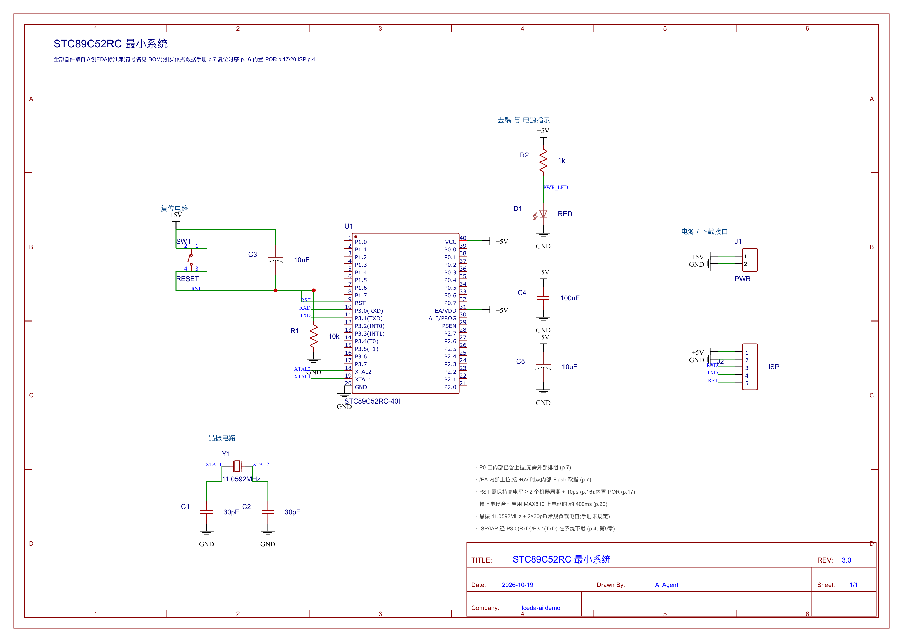
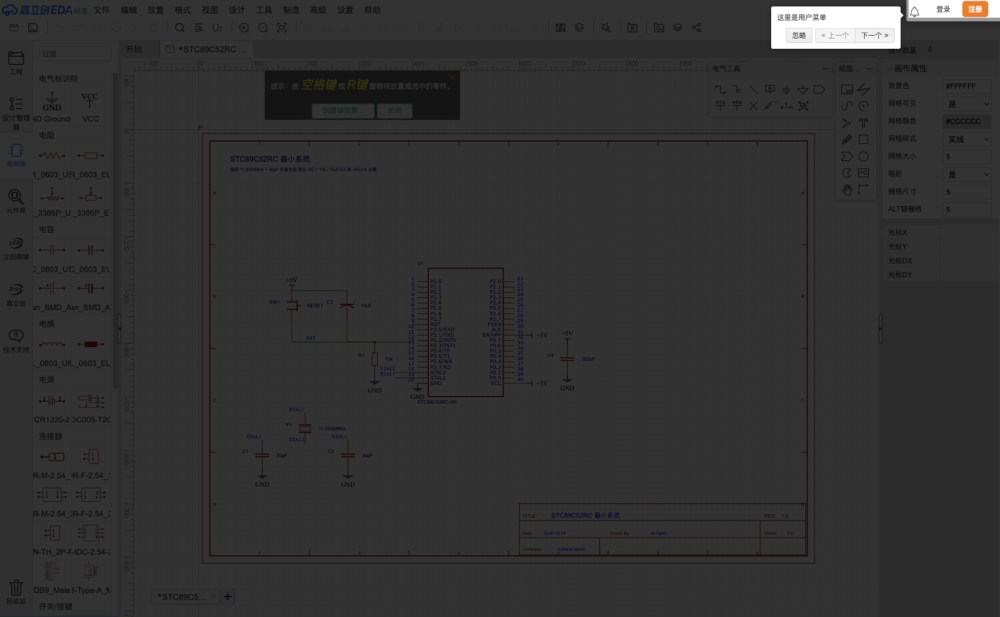

# dsh-plugin-lceda-ai

DeepSeek Harness 插件 + 命令行工具链,版本 `0.0.1-beta`,协议 GPL-3.0。

让 AI Agent(以及命令行脚本)**看懂、渲染、创作、编辑、导出**嘉立创EDA(标准版)原理图,并且使用编辑器自己的器件库。

- 输入:立创EDA 标准版原理图(`.esch` / `Sheet_1.json`,都是同一份 JSON)
- 输出:SVG / PNG / PDF(文本可搜索的矢量 + 位图)、BOM 与网络表报告(Markdown/JSON)、**可直接被立创EDA 打开的 JSON**
- 也能反向:从零创建图纸、放置真实库器件、按引脚引用连线、结构化编辑并校验

> 非官方工具:解析规则来自对标准版文件格式的实测与比对,与立创EDA 官方无关。



## 为什么需要它

原理图 `.esch` 是“记录串”的集合(`LIB~...#@$P~...^^...`),人和 AI 都很难直接读。这个工具把它变成
**结构化模型 → 网络表 → 可读图/报告**,并且能反向往回写,还能把写出的文件交给真实编辑器打开验证。

## 特性

| 能力 | 说明 |
|---|---|
| 查看/理解 | 器件清单、逐引脚表、网络表(含命名冲突检测)、导线/结点/标签统计 |
| 渲染 | SVG(文本可搜索)、PNG、PDF;忠实描边,颜色/线宽/字体按记录还原 |
| 创作 | 新建 A4 图框+标题栏、放器件、按引脚引用连线、加标签/电源地/结点/文字 |
| 编辑 | 改值/位号/属性、移动、旋转、复制、删除、增删导线/结点/标签/标志;带网络表 diff 与告警、`.bak` 备份 |
| 导出 | 立创EDA 可直接打开的 JSON(与编辑器落盘逐键一致)、工程目录形式 |
| 器件库 | **立创EDA 标准库 → 立创商城 → 内置符号** 三级择优,并用手册引脚表校验符号 |
| 自动布局 | spec 不写坐标也能出图:按网表分侧摆放、正交避障走线,并自检“有没有把两个网络短接” |
| 离线缓存 | 标准库搜索/取件落盘到 `~/.cache/lceda-ai`,批量建图不再重复请求;`cache` 可查看/清空 |
| 多图纸工程 | `project` 汇总整个工程:合并 BOM、逐图纸统计、**跨图纸联动**(按 Net Port / NetFlag / NetLabel 三种作用域标注是否真的连通)、网络分类 |
| Agent 集成 | Harness 插件注册 7 个 `lceda_*` 工具;子进程调用 CLI,改代码即生效 |

## 安装

```bash
npm install          # Node.js >= 20
npm test             # 52 个单元测试(含工具 Schema、自动布局、缓存、工程聚合)
npm run verify       # 端到端自检(含标准库/商城联网检查,可加 --offline)
```

## 快速开始

```bash
# 1. 看懂一张图
npx lceda-ai read  examples/stc89c52rc-minimal-v3.esch
npx lceda-ai read  examples/stc89c52rc-minimal-v3.esch --json

# 2. 出图 / 出报告
npx lceda-ai convert examples/stc89c52rc-minimal-v3.esch -o ./out --formats svg,png,pdf,report

# 3. 导出给立创EDA(文件 → 打开 → 嘉立创EDA)
npx lceda-ai export examples/stc89c52rc-minimal-v3.esch --project ./MyProject
```

## 命令

| 命令 | 作用 |
|---|---|
| `convert <sch> -o <dir> [--formats ...] [--scale 4]` | 批量转 svg/png/pdf/report |
| `read <sch> [--json]` | 结构 + 网络表摘要 |
| `create <out.esch> [--title --company --rev --date --drawn-by]` | 新建图纸 |
| `find <query> [--file <sheet>] [--json]` | 标准库 / 商城编号 / 内置库 / 工程内器件 |
| `place <sch> <符号或uuid或C编号> [--ref --value --at x,y --rot --std --standard --pins]` | 放一个器件,返回引脚坐标 |
| `build <spec.json> -o <out.esch> [--auto-layout] [--export]` | 按声明式 spec 画整图;`--auto-layout` 自动摆放并正交走线 |
| `project <dir> [-o <out>] [--render]` | 多图纸工程汇总(合并 BOM / 网络分类 / 跨图纸同名网络) |
| `pcb read <file\|dir>` | 解析 PCB/封装:层、器件、焊盘、走线、过孔、铺铜、板框、DRC |
| `pcb render <file\|dir> -o <out>` | PCB 分层渲染 svg/png/pdf + 报告(`--view bottom` 看底层) |
| `pcb route <board.json> -o out` | 网格 A* 自动布线(两层 + 换层过孔)+ 间距自检(`--cell/--clearance/--width`) |
| `pcb pour <board.json> -o out` | 铺铜:洪泛填充 + 热焊盘 + 孤岛移除 + 自检(`--net/--layer/--no-thermal/--keep-island`) |
| `pcb via <board.json> -o out` | 缝合孔:按规则在铜皮内铺过孔栅格 + 间距/孔到孔自检(`--net/--spacing`) |
| `pcb drc <board.json>` | 设计规则检查:线宽/间距/过孔环/孔到孔/板边/丝印压盘/**连通性**(`-o report.md`) |
| `pcb gerber <board.json> -o dir` | 导出 Gerber(RS-274X)+ Excellon 钻孔 + 自检(`--manifest`) |
| `pcb bom <board.json> -o dir` | 导出 BOM + 贴片坐标(CSV + XLSX,可用原理图补 LCSC 号)(`--sch`) |

### 作为 DSH 工具(Harness 里直接调用)

原理图 8 个 + PCB 9 个,共 **17 个工具**;PCB 这套可以一次调用跑完整条流水线:

| 工具 | 作用 |
|---|---|
| `lceda_pcb_build` | 原理图 → PCB:**布局 → 布线 → 铺铜 → 缝合孔 → Gerber → BOM** 一条龙(各阶段可选) |
| `lceda_pcb_read` | 读板:层/器件/焊盘/走线/过孔/铜皮/板框/网络/DRC 规则 |
| `lceda_pcb_render` | 分层渲染 svg/png/pdf + 报告(`view` 选正反面) |
| `lceda_pcb_route` | 两层网格 A* 自动布线 + 间距自检 |
| `lceda_pcb_pour` | 铺铜(热焊盘 / 孤岛移除)+ 越界自检 |
| `lceda_pcb_via` | 缝合孔(按过孔边缘精确校距)+ 孔到孔自检 |
| `lceda_pcb_drc` | 7 类设计规则检查,可出 markdown 报告 |
| `lceda_pcb_gerber` | 导出 Gerber + Excellon(自检 flash/钻孔/板框) |
| `lceda_pcb_bom` | 导出 BOM + 贴片坐标(CSV/XLSX) |
| `pcb fp <LCSC\|uuid\|封装名>` | 查器件对应的封装(焊盘数/间距/尺寸/层) |
| `pcb map <sch\|dir>` | 把原理图每个器件映射到封装并校验 **引脚↔焊盘**(缺失=错误,多余=提示) |
| `pcb from-sch <sch> -o board.json` | **原理图→PCB**:规则化布局 + 把网表写进焊盘(`--place rule\|shelf`,`--export` 顺带出图) |
| `cache [stats\|clear]` | 查看或清空器件缓存(任何命令都可加 `--no-cache`) |
| `edit <sch> --ops '<json>' [--dry-run] [--out] [--preview]` | 结构化编辑 |
| `export <sch> [-o out.json] [--project <dir>]` | 导出可导入立创EDA 的 JSON |

### 声明式建图(spec)

```jsonc
{
  "title": "STC89C52RC 最小系统", "rev": "3.0", "company": "…",
  "components": [
    { "symbol": "resistor", "ref": "R1", "value": "10k", "x": 300, "y": 430, "rot": 90 },
    { "part": { }, "ref": "U1", "x": 520, "y": 400 }
  ],
  "wires":  [ { "from": "U1.9", "to": "Y1.1" }, { "points": [[340,465],[300,465]] } ],
  "labels": [ { "text": "XTAL1", "at": "U1.19", "anchor": "end" } ],
  "flags":  [ { "text": "+5V", "kind": "part_netLabel_+5V", "at": "U1.40", "rot": 90 } ],
  "junctions": [ { "at": [300, 368] } ],
  "texts":  [ { "text": "说明", "at": [60, 60], "size": 10 } ]
}
```

**跨图纸联动**:`ports: [{ text, at, rot }]` 生成**网络端口 Net Port**(跨图纸连通);
`flags: [{ text, kind, at, rot }]` 生成电源/地标志(全局连通);`labels: [{ text, at }]` 是普通网络标签(**仅本图纸**)。
同名网络是否真的连通取决于用哪一种 —— `project` 报告会直接告诉你。

`at`/`from`/`to` 可以是引脚引用(`"U1.9"`)或坐标。

**不想手算坐标**:给 spec 加 `"layout": "auto"`(或构建时加 `--auto-layout`),没写 `x/y` 的器件会自动摆放,
`{from,to}` 连线会自动走正交折线:

```jsonc
{ "layout": "auto",
  "components": [ { "symbol": "stc89c52rc", "ref": "U1" }, { "symbol": "crystal", "ref": "Y1" } ],
  "wires": [ { "from": "U1.19", "to": "Y1.1" } ] }
```

规则:引脚最多的器件当锚点居中;其余器件按**网表连到锚点哪一侧**分左右两列(会沿网表传递),
摆放时避开已占区域;走线沿引脚朝向外伸 20,再折向目标,避开器件本体、其他引脚与已布导线。
构建结束会做一次**短路自检**:如果某条自动走线把两个本该独立的网络并在了一起,会给出告警并要求你显式写 `points`。
手写的 `x/y` 永远优先,所以可以“手工放几个关键器件 + 其余自动”。

### 结构化编辑

```bash
npx lceda-ai edit sheet.esch --ops '[
  {"op":"set_value","ref":"C1","value":"22pF"},
  {"op":"move","ref":"R2","dy":-10},
  {"op":"add_wire","points":[[100,100],[200,100]]},
  {"op":"add_net_label","x":150,"y":100,"text":"NODE_A"}
]' --dry-run
```

可用操作:`describe` `set_value` `set_designator` `set_attr` `move` `rotate` `delete_component`
`duplicate_component` `add_wire` `add_junction` `add_net_label` `add_net_flag`
`delete_element` `delete_wires_at` `move_element`。

每次编辑都会返回:改动清单、**网络表 diff**(哪些引脚换了网络)、告警(悬空导线、
未生效标签、单引脚网络、重复位号)。`--dry-run` 不落盘,写盘自动留 `.bak`。

## 器件库:标准库优先

| 优先级 | 来源 | 说明 |
|---|---|---|
| 1 | **立创EDA 标准库** | 编辑器“元件库”同一套接口(`lceda.cn/api/components`);按标题或 uuid 取,返回真实符号 |
| 2 | **立创商城** | `easyeda.com/api/products/{LCSC}/components`;标准库没有时按编号取 |
| 3 | 内置符号 | 离线兜底(自制画法,仅应急) |

搜索结果与器件文档会缓存到 `~/.cache/lceda-ai`(可用 `LCEDA_CACHE_DIR` 改位置、`LCEDA_NO_CACHE=1` 或 `--no-cache` 关闭):

```bash
npx lceda-ai cache stats      # 有多少条、占多少空间
npx lceda-ai cache clear
```

```bash
npx lceda-ai find R_0603_US        # 标准库搜索:uuid / 封装
npx lceda-ai find C25804           # 商城器件
npx lceda-ai place out.esch R_0603_US --ref R1 --value 10k --at 300,400 --rot 90
npx lceda-ai place out.esch --std 96ab93705fad467397e1ee5fa4b8c4da --ref R2 --at 400,400
```

**符号质量校验**:同名器件是用户共建的,引脚名可能写错。工具内置引脚参照表
(`src/library.js` 的 `PINOUT_REFERENCES`),按“引脚名匹配率 + 图形规整度”挑符号。已覆盖:

| 器件 | 封装 | 出处 |
|---|---|---|
| STC89C52RC | DIP-40 | STC89C51RC/RD+ 数据手册 p.7 |
| NE555 | DIP-8 | TI/ST 555 数据手册 |
| LM358 | DIP-8 | TI LM358 数据手册 |
| 74HC595 | DIP-16 | Nexperia/TI 数据手册 |
| ATmega328P | DIP-28 | Microchip 数据手册 |
| AMS1117-3.3 | SOT-223 | AMS 数据手册 |
| CH340G | SOP-16 | WCH 数据手册 |

匹配容忍写法差异:`P3.0(RXD)`、`ALE/PROG`、`NRESET`、`VDD/VCC`、`VSS/GND` 都能对上;
真正的错误(例如 31 号脚写成 `P4.6`)照样会被淘汰。引脚表通过 `findPinoutReference()` 也能按**库标题**命中,
所以从标准库直接放 `NE555`、`74HC595` 也会被校验。

## 导出到立创EDA

```bash
npx lceda-ai export sheet.esch -o Sheet_1.json          # 单文件
npx lceda-ai export sheet.esch --project ./MyProject    # 工程目录 + 导入说明
```

导入:立创EDA 标准版 **顶部菜单 → 打开 → 嘉立创EDA → 选择 json**。
导出的 json 与编辑器自己保存的文件**逐键一致**(顶层 5 键、`head` 12 键、单行紧凑格式)。



## Harness 插件(8 个工具)

本包本身就是 Harness bundle(`dsh-plugin-lceda-ai`,patch 见 `cordis.patch.yml`,row id `lceda-schematic-ai`),注册:

| 工具 | 作用 |
|---|---|
| `lceda_read_schematic` | BOM + 引脚表 + 网络表 |
| `lceda_render_schematic` | SVG/PNG/PDF/报告 |
| `lceda_create_schematic` | 新建图纸(可带 spec 一次画完,可顺带出图) |
| `lceda_place_component` | 放器件(标准库标题/uuid/LCSC/内置) |
| `lceda_find_component` | 找器件(标准库优先) |
| `lceda_edit_schematic` | 结构化编辑 + 校验 + 预览 |
| `lceda_export_json` | 导出可导入 JSON / 工程目录 |
| `lceda_project_overview` | 多图纸工程汇总:**合并 BOM、跨图纸联动(端口/标志/标签作用域)、网络分类** |

安装:

```bash
# 在 Harness 里(plugin_manager),target 指向本目录
plugin_manager install_bundle  target: /absolute/path/to/dsh-plugin-lceda-ai
# 或者直接启用已安装的 bundle
plugin_manager set_bundle      target: dsh-plugin-lceda-ai  enabled: true
```

> 插件默认**不自动启用**;安装后再 `set_bundle enabled:true` 才会注册工具。
> 工具 schema 有回归测试(`test/plugin-schema.test.js`):参数名不能撞 JSON Schema 保留字
> (例如早期用 `title` 会导致整个函数 schema 非法)。

所有工具都通过**子进程**调用 `bin/lceda-ai.js`:改 `src/` 无需重载插件,也不会把
`sharp` 这类原生依赖带进宿主进程。

## 项目 Skill

`skills/lceda-schematic/SKILL.md` 是给 Agent 的工作手册(决策表、标准流程、必须遵守的规矩、已知坑),
通过 `.dsh/skills/lceda-schematic` 软链被 Harness 自动发现。

## 架构

```
bin/lceda-ai.js      CLI(懒加载重模块;--json 输出纯 JSON)
src/parser.js        .esch → 结构化模型(器件/引脚/导线/标签/标志/图形)
src/netlist.js       并查集网络提取 + 命名/别名/冲突判定
src/svg.js           渲染器(矢量、文本可搜索)
src/export.js        SVG → PNG(sharp)/ PDF(pdf-lib)
src/report.js        Markdown / JSON 报告
src/edit.js          编辑引擎:操作、网络表 diff、校验、原子写入 + .bak
src/symbol.js        符号生成(内置库)、器件构造、电源/地标志
src/create.js        新建图纸、放器件、spec 构建器、SchematicBuilder
src/library.js       标准库 / 商城 / 内置库、引脚校验、符号择优
src/cache.js         器件与搜索结果落盘缓存(可关闭、可清理)
src/layout.js        自动布局 + 正交避障走线
src/project.js       多图纸工程聚合、网络分类
src/exportjson.js    导出立创EDA 可打开的 JSON
src/path.js          路径解析/变换(旋转、平移)
docs/format.md       .esch 文件格式笔记(踩坑记录)
```

## 示例

`examples/` 是 **STC89C52RC 最小系统**:全部器件取自立创EDA 标准库(符号 uuid 已锁定),
并依据 STC89C51RC/RD+ 数据手册标注了引脚、复位时序、POR、ISP 的出处。
详见 [`examples/README.md`](examples/README.md)。

## PCB 支持(进行中)

按 [`docs/roadmap-pcb.md`](docs/roadmap-pcb.md) 推进,已完成:

- **P-01 解析**:`pcb read` —— 记录字段顺序取自编辑器解析模块,坐标单位实测为 **0.254mm/单位(10 mil)**,
  并确认 **LIB 子记录是绝对坐标**;真实 0603/2.54mm 排针封装做 fixture,离线可测。
- **P-02 渲染**:`pcb render` —— 分层配色、顶层/底层视图、图例、报告;与编辑器打开同一文档比对一致。
- **P-03 封装管理**:`pcb fp` / `pcb map` —— 按立创编号(产品接口 `packageDetail`)或**封装名**(标准库封装类目)
  找封装,并校验引脚↔焊盘;实测 v3 最小系统 13/13 匹配。
- **P-04 原理图→PCB**:`pcb from-sch` —— 记录序列化器 + 摆放 + 网表写入焊盘 net 字段;
  生成的板子已在编辑器里打开验证。示例见 `examples/pcb-demo/`。
- **P-05 元件布局**:按网表聚簇 + 20 个候选布局小搜索,输出飞线长度/重叠/越界质量报告;
  实测比货架排布**飞线短 37%**、板面积更小、零重叠零越界。
- **P-06 布线**:`pcb route` —— 两层网格 A*(换层过孔)+ 精确间距自检;实测 v3 最小系统 **33/40 网络布通、0 违规**;
  顺带修掉 POLYGON 焊盘被当成点、以及封装择优误配 LQFP 两个真 bug(现在支持 `--footprint U1=DIP-40`)。
- **P-07 铺铜**:`pcb pour` —— 栅格洪泛 + 热焊盘辐条 + 孤岛移除,输出 `COPPERAREA`;
  实测 GND 铜 **1979mm² / 23 个多边形 / 0 越界**,编辑器识别出 23 个铜皮区域。
- **P-08 过孔**:`pcb via` —— 规则模型 + 缝合孔栅格(5mm → 60 个,0 违规);
  顺带修掉「走线被写成 2.54mm 宽」这个影响全部布线结果的 bug。
- **P-09 DRC**:`pcb drc` —— 7 类检查(含按铜连通分量判断的连通性),demo 四阶段全 PASS;
  它比布线自检更严,一次抓出 9 处走线压走线并促成 hard-blocking 修复。
- **P-10 Gerber**:`pcb gerber` —— 自研 RS-274X + Excellon(含丝印笔画字体、G36/G37 铜皮、Y 轴翻转),
  并用第三方 **gerbonara** 独立解析+渲染校验(1239 个对象全通过)。
- **P-11 BOM/贴片坐标**:`pcb bom` —— 分组 BOM(经 `bind_sch_id` 对回原理图取 LCSC 号)+ 装配坐标系贴片坐标,
  CSV + 自研 XLSX;XLSX 由 **openpyxl** 独立打开验证。

## 路线图(未实现)

PCB 方向(原理图转 PCB、封装管理、布局、布线、铺铜、过孔、DRC、Gerber、BOM/贴片坐标)的技术方案已写成
[`docs/roadmap-pcb.md`](docs/roadmap-pcb.md):每个工作流给了 2–3 条可选路线、推荐路线与验证方式,
并附 REA 得到的事实(文档类型、跨图纸用 **Net Port**、封装可从商城接口取)。

## PCB 工作流(P-01…P-12 已完成)

```bash
# 一条命令从原理图做到制造文件
node bin/lceda-ai.js pcb from-sch examples/stc89c52rc-minimal-v3.esch -o board.json --footprint U1=STC89C52RC-DIP-40
node bin/lceda-ai.js pcb route  board.json        -o board-routed.json
node bin/lceda-ai.js pcb pour   board-routed.json -o board-poured.json --net GND
node bin/lceda-ai.js pcb via    board-poured.json -o board-stitched.json --net GND --spacing 5
node bin/lceda-ai.js pcb drc    board-stitched.json -o drc.md
node bin/lceda-ai.js pcb gerber board-stitched.json -o fab/ --manifest
node bin/lceda-ai.js pcb bom    board-stitched.json -o bom/ --sch examples/stc89c52rc-minimal-v3.esch
```

完整示例与各阶段产物见 [`examples/pcb-demo/`](examples/pcb-demo/)。

## 校验(可选)

Gerber 导出用第三方解析器 [gerbonara](https://pypi.org/project/gerbonara/) 做独立校验(测试在缺少它时会自动跳过):

```bash
python3 -m venv /tmp/gerb-venv && /tmp/gerb-venv/bin/pip install gerbonara
npm test          # 会额外跑一遍“独立解析器接受这些文件”的用例
```

## 开发

```bash
npm test                 # 单元测试(解析/网络表/编辑/建图/导出/引脚校验)
npm run verify           # 端到端 15 项自检
npm run example          # 重新生成 v3 示例全套产物
```

## 已知限制

- 只支持**标准版**(`docType` 1);专业版格式不同。
- 渲染是忠实描边:编辑器里画得难看的库符号,渲染出来一样难看。
- 自动布局是启发式排版(分侧 + 正交走线 + 短路自检),不会像人一样追求美观;关键器件仍建议手写坐标。
- 内置符号只有 8 类(8051/R/C/极性C/晶振/按键/LED/排针),其余请用标准库/商城。
- 商城按编号取件可用;关键词搜索接口有 WAF,关键词检索请走标准库。
- `.esch` 里若含编辑器私有插件对象,编辑时原样保留但不理解其语义。
- **总线 / 层次图只做读取侧聚合,不写这类记录**。检查过的真实工程(`Sheet_*.json`)里只有
  `LIB/F/W/N/J` 五类记录,`BUS` 只出现在 `VBUS` 这类网络名中,`B~` 是图框文字与图片数据;
  在拿到真实的总线/层次端口样本前,工具不会凭猜测生成这类记录,以免产出编辑器打不开的文件。
  跨图纸的连通性也不臆断(标准版里网络标志/端口是全局的,普通网络标签是否跨图纸连通取决于标签类型),
  `project` 只把同名网络列出来供人工确认。

## 目录结构

```
index.js             Harness 插件入口(注册 7 个 lceda_* 工具)
cordis.patch.yml     bundle patch(id: lceda-schematic-ai)
locale/ icon.svg     插件显示资源
bin/ src/ test/ scripts/ docs/ skills/ examples/
├── docs/format.md            .esch 文件格式笔记
├── docs/images/              编辑器实机验证截图
├── examples/                 示例工程与生成脚本
└── skills/lceda-schematic/   项目 Skill
```

`node_modules/`、`.venv/`、`datasheet/`、`out/`、`examples/_generated/`、`examples/private/`
不纳入版本管理(见 `.gitignore`)。
