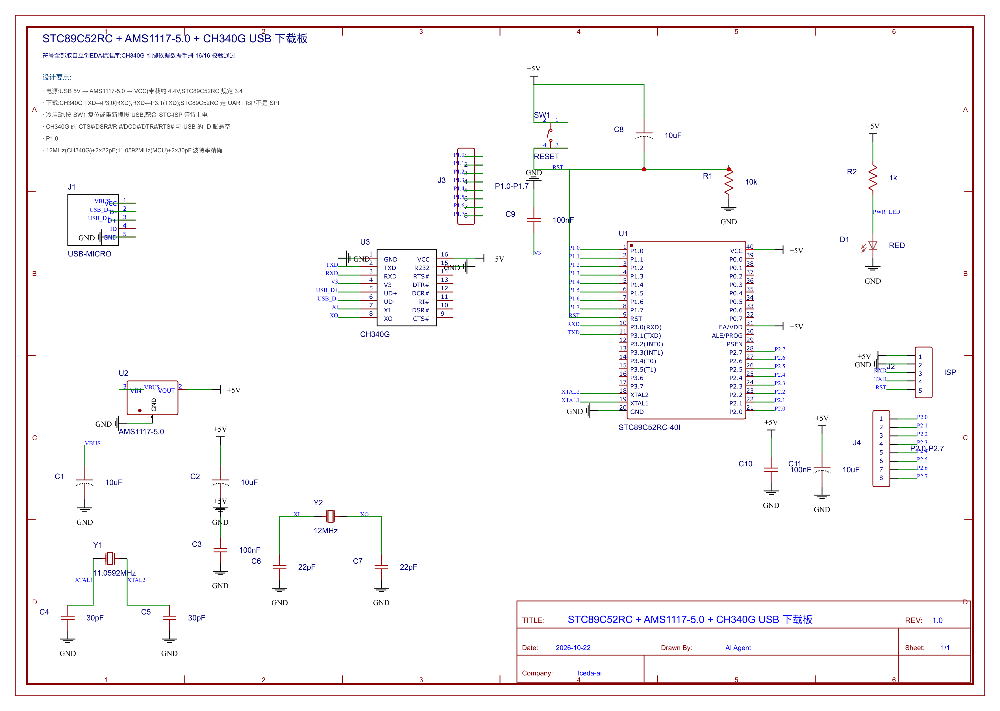

# STC89C52RC + AMS1117-5.0 + CH340G USB 下载板

一块完整的、可用立创EDA打开的单片机下载板:USB 供电 → LDO 稳压 → CH340G 转串口 →
STC89C52RC 的 UART ISP 下载,并把 P1/P2 两组 IO 引出到 2.54mm 排针。



## 设计要点

| 功能块 | 器件 | 说明 |
|---|---|---|
| 主控 | **U1 STC89C52RC-40I**(DIP-40) | 11.0592MHz + 2×30pF,波特率精确 |
| 电源 | **U2 AMS1117-5.0**(SOT-223) | USB 5V → VCC(带载约 4.4V);STC89C52RC 规定 3.4~5.5V,余量充足 |
| USB 转串口 | **U3 CH340G**(SOP-16) | 12MHz + 2×22pF;TXD→P3.0(RXD)、RXD←P3.1(TXD);V3 脚 100nF;R232 接地为 TTL 电平 |
| 接口 | **J1 Micro-USB** / **J2 ISP(1×5)** / **J3 P1.0~P1.7** / **J4 P2.0~P2.7** | ISP 排针引出 VCC/GND/RXD/TXD/RST,也可直接接 USB-TTL 模块 |
| 复位 | SW1 + R1 10k + C8 10µF | 上电复位 + 手动复位(STC-ISP 等待上电时按 SW1) |
| 指示 | R2 1k + D1 RED | 电源指示 |
| 去耦 | C1/C2 10µF、C3/C9/C10 100nF、C11 10µF | LDO 输入输出、CH340G V3、MCU |

**关于"SPI 下载"**:STC89C52RC 的 ISP 是 **UART**(P3.0/P3.1),不是 SPI。本板按 UART ISP 设计,
并把这两根线同时引到 J2 排针,方便用现成 USB-TTL 模块下载。CH340G 的 CTS#/DSR#/RI#/DCD#/DTR#/RTS#
与 USB 的 ID 脚悬空(未使用)。

## 文件说明

| 路径 | 内容 |
|---|---|
| `../stc89c52rc-usb-isp.esch` | 原理图(嘉立创EDA 格式,可直接打开) |
| `stc89c52rc-usb-isp.json` / `sch/Sheet_1.json` | 立创EDA 可导入的工程 JSON |
| `schematic/` | 原理图渲染:png / svg / pdf / 报告 |
| `board.json` → `board-routed.json` → `board-poured.json` → `board-stitched.json` | PCB 四个阶段(布局 / 布线 / 铺铜 / 缝合孔) |
| `pcb-placed/` `pcb-routed/` `pcb-final/` | 各阶段 PCB 渲染 |
| `gerber/` | **Gerber(RS-274X)7 个 + Excellon 钻孔 1 个** + `gerber.manifest.json` 自检结果 |
| `bom/` | BOM 与贴片坐标(CSV + XLSX,两个工作表) |
| `drc.md` | 设计规则检查报告(逐条列出违规与位置) |
| `build.mjs` | 一键重建整条流水线 |

## 流水线结果

```
1. 布局  24 器件 / 128 焊盘 / 53 网络 | 板框 81.95 x 77.93 mm | 重叠 0 | 越界 0
2. 布线  优先 9/13 + 其余 23/33 = 32/46 网络 | 228 段走线 | 118 过孔
3. 铺铜  GND 3732 mm² | 33 个多边形 | 移除孤岛 22
4. 缝合孔 101 个(盘 0.508mm / 孔 0.254mm / 环 0.127mm)| 违规 0
5. DRC   2 错误 / 14 提示(见下)
6. Gerber 8 个文件,自检全部一致(347 flash / 1147 描边 / 284 钻孔 / 板框 81.95×77.93)
7. BOM   17 行 / 24 器件 | 贴片 24(全顶层)
```

**关键网络全部布通**:RXD、TXD、RST、XTAL1、XTAL2、XI、XO、VBUS、+5V —— 下载功能所需的连线都通了;
GND 由铺铜连通(不需要走线)。

## 已知问题(如实记录)

1. **USB_D+/USB_D-/V3 未布通**。Micro-USB 焊盘间距 0.65mm(焊盘宽 0.4mm,间隙仅 0.25mm),
   CH340G 是 1.27mm 间距 —— 在 0.254mm 线宽 + 0.254mm 间距规则下,从焊盘中心向外只能沿焊盘长边逃逸,
   而路由器工作在 **0.254mm 栅格**上,量化误差 0.127mm 就足以吃掉间距。这两个网络单独布线也失败。
   实际工程做法是给这类细间距网络单独的**网络类规则**(如 0.15mm 线宽/间距),这是路线图里尚未实现的部分;
   也可以手工从焊盘长边扇出。
2. **2 处 DRC 错误**:
   - `clearance`:GND 走线与 TXD 在 CH340G 附近实测 0.214mm(要求 0.254mm)
   - `hole-to-hole`:一个 +5V 过孔与相邻孔实测 0.064mm(要求 0.508mm)
   两处都在 `drc.md` 里给出了精确坐标,可在编辑器里手工微调。
3. **14 条"未连通"提示**:主要是 P1/P2 引出网络与上面那三个细间距网络。
4. `D1` 用的是库里的 `CHIPLED-0603-TTW` 封装(4 个焊盘,其中两个是装饰盘),工具已给出"焊盘多于引脚"的告警。
5. 布局是自动聚簇的结果(飞线 1644mm),不如人工布局紧凑;本板可再优化。

## 复现

```bash
node examples/build-stc89c52rc-usb-isp.mjs          # 生成原理图
node examples/stc89c52rc-usb-isp/build.mjs          # 跑完整 PCB 流水线
```

## 独立校验

- **立创EDA**:打开 `board-stitched.json` → 129 焊盘 / 220 过孔 / **33 个铜皮区域** / 61 个丝印文字 /
  389 段带网络走线(38 个网络)全部识别。
- **gerbonara 1.6.3**(第三方 Gerber 解析器):8 个文件、**2987 个对象**全部解析并渲染成功;
  板框 82.963×78.946mm(= 81.95 + 线宽 1.016),顶层铜 81.026×76.962mm(= 板框 − 2×0.3 板边距)。
- **openpyxl 3.1.5**:XLSX 可打开,`BOM` A1:J18、`CPL` A1:G25,数值/字符串类型正确。
